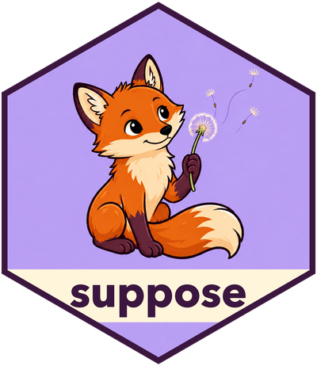

# Suppose 

Make beliefs explicit. Explore what follows. Decide what to learn next.

Suppose is an R package and local chat workbench for developing a scientific
question into a record you can inspect and revise. Start with your own words,
clarify your expectations, and add a numerical model when it helps. Keep the
assumptions, evidence, and reasons for changing your mind together.

## Start with a belief

A useful inquiry does not need a fitted model:

```r
library(suppose)

belief <- claim(
  "A longer cure may make this coating more durable.",
  author = "Researcher",
  unresolved = "Does the improvement justify the extra time?"
)
record <- elicitation_record(belief)
```

When you are ready for numbers, explore an invented strength example:

```r
example <- suppose_example()
prior <- example$revisions[[3]]$candidate
plot_prior(prior, view = "contrast")
```

The plot separates uncertainty about the mean difference from variation between
future measurements. Change an assumption and inspect how the consequences change.

## Choose your next step

- **New to Suppose?** [Get started](vignettes/suppose.Rmd) with a belief,
  a revision, and a portable record.
- **Prefer conversation?** [Use the workbench](vignettes/workbench.Rmd)
  to review suggestions, attach measurements, and explore models.
- **Ready for a model?** [Inspect prior consequences](vignettes/prior-consequences.Rmd),
  [learn from measurements](vignettes/measurements.Rmd), or
  [fit and revise a regression](vignettes/regression.Rmd).

## Install

Suppose is in development and is not on CRAN. With access to the private
repository, install the core package using an authenticated GitHub connection:

```r
pak::pak(c("JamesHWade/suppose", "ggplot2"), dependencies = NA)
```

Plotting uses ggplot2. The chat workbench needs additional development packages;
see [installation and workbench setup](vignettes/workbench.Rmd#installation).
To open the manual workbench after installing those dependencies:

```r
suppose_app()
```

With an ellmer provider configured, pass a chat object or its constructor:

```r
suppose_app(chat = ellmer::chat_openai())
suppose_app(chat = ellmer::chat_openai)
```

## What the results mean

Suppose keeps a distinction between a stated belief, its modeled consequences,
and an empirical check. Accepting a record means that a person reviewed it;
it does not establish that a claim is true. Supported models are deliberately
bounded. See [methods and limits](vignettes/methods.Rmd) before drawing
scientific conclusions.

The package is experimental. The worked examples demonstrate implemented
behavior; intended-scientist acceptance testing remains open.

Contributions: [development guide](CONTRIBUTING.md). License: [MIT](LICENSE.md).
